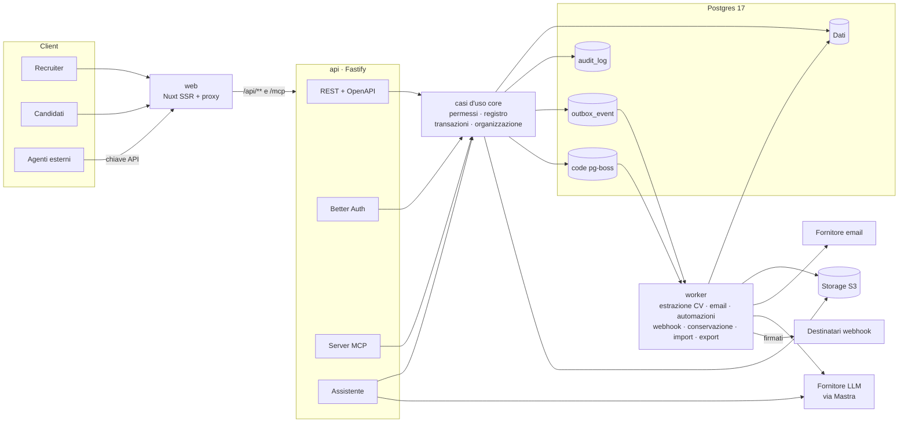
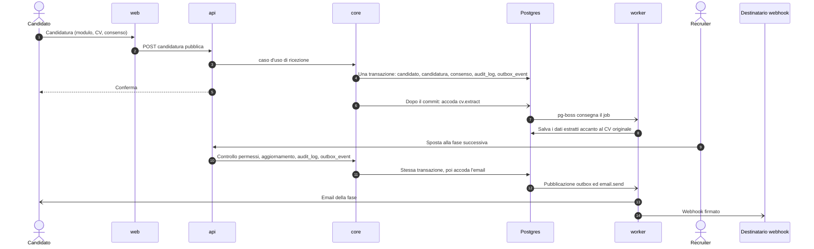

<p align="center">
  <picture>
    <source media="(prefers-color-scheme: dark)" srcset="docs/assets/logo-dark.svg">
    
  </picture>
</p>

<p align="center"><strong>L'ATS agentico a sorgente disponibile, dalla parte del candidato.</strong></p>

<p align="center">
  <a href="LICENSE"></a>
  <a href="https://github.com/fabrilallo/team-tracker/actions/workflows/ci.yml"></a>
  <a href="CONTRIBUTING.md"></a>
  
</p>

<p align="center"><a href="README.md">English</a> · <a href="docs/PRODUCT.md">Prodotto</a> · <a href="docs/ARCHITECTURE.md">Architettura</a> · <a href="CONTRIBUTING.md">Contribuire</a></p>

> **Nome in codice.** `team-tracker` è un nome di lavoro. Il nome del prodotto non è ancora deciso: si legge dalla configurazione (`PLATFORM_*`), non è mai scritto nel codice.
>
> La documentazione tecnica in `docs/` è in inglese.

## Perché

**L'ATS non è un nemico.** Chi si candida spesso immagina l'ATS come una scatola nera che nasconde il CV o taglia
fuori le persone prima che qualcuno le legga. Il software fa quello che decide chi lo gestisce: lo stesso strumento
può lasciare i candidati senza risposta oppure rispondere a tutti. La differenza sta in come lo si configura e lo si usa.

Per questo il codice di team-tracker è pubblico. Le regole che applica sono codice che chiunque può leggere, verificare e
migliorare, e le buone pratiche sono parte del prodotto invece di essere lasciate alla buona volontà. La maggior parte
degli strumenti di selezione nasconde a chi si candida la retribuzione, il processo e l'esito; qui la trasparenza è
strutturale, non opzionale: un'installazione non può disattivare questi principi.

- **RAL in chiaro.** Un annuncio senza fascia retributiva non si può pubblicare.
- **Processo di selezione dichiarato.** Le fasi, chi le conduce e quanto dura ciascuna sono visibili prima di candidarsi.
- **Nessuna candidatura senza esito.** Ogni candidato riceve una risposta; un annuncio con candidature aperte non si può chiudere.
- **Nessuna decisione automatica.** L'assistente lavora sul processo. Non ordina, non assegna punteggi e non scarta persone.
- **Pronto per gli agenti.** Tutto ciò che è nell'interfaccia è disponibile tramite API REST (OpenAPI) e server MCP, con gli stessi permessi.
- **GDPR by design.** Consenso versionato, conservazione e cancellazione automatica, diritti dell'interessato, export completo in formati aperti.

Stato: pre-1.0 (vedi il [changelog](CHANGELOG.md)). Definizione completa del prodotto: [docs/PRODUCT.md](docs/PRODUCT.md).

## Funzionalità

**Selezione**
- Annunci strutturati con uno standard di pubblicazione deterministico (retribuzione, processo, contratto, modalità di lavoro) e controlli di conformità al diritto italiano
- Pagina carriere con dati strutturati (`JobPosting`), feed XML e API pubblica degli annunci in sola lettura
- Editor della pagina carriere: copertina con immagine o video, galleria, valori, numeri, testimonianze e altro, con anteprima dal vivo, bozze e pubblicazione; video incorporati nel rispetto della privacy
- Candidature senza registrazione, con consenso versionato
- Pipeline con le fasi dichiarate nell'annuncio; ricerca nel database dei candidati; CV originale accanto ai dati estratti

**Collaborazione**
- Organizzazioni, ruoli e team di selezione per annuncio
- Feedback dei colloqui senza login, tramite link personali
- Raccolta del fabbisogno, approvazione facoltativa di budget e retribuzione, segnalazione degli annunci fermi
- Report: tempo di assunzione, conversione per fase, fonti, tempi di risposta

**Comunicazione e automazioni**
- Modelli di email, invii singoli e massivi, email in arrivo collegate al candidato
- Scadenze di risposta e promemoria; azioni automatiche per fase (nessuna decide su un candidato)

**Agenti e integrazioni**
- API REST con OpenAPI, chiavi API, server MCP, assistente di processo (modelli via Mastra, spento di default)
- Webhook firmati alimentati da una outbox transazionale

**Privacy e dati**
- Conservazione, cancellazione automatica, diritti dell'interessato, registro delle azioni in sola aggiunta
- Import da CV e fogli di calcolo con anteprima e annullamento; export completo

## Schermate

| | |
|---|---|
| <br>**Pipeline**: i candidati nelle fasi dichiarate dell'annuncio | <br>**Editor dell'annuncio**: RAL e processo obbligatori, anteprima dal vivo |
| <br>**Pagina carriere**: sezioni costruite con l'editor e anteprima dal vivo | <br>**Candidato**: fase, note e feedback dei colloqui, senza punteggi |

I dati sono inventati. Per rigenerarle: `pnpm --filter @tt/e2e screenshots` con lo stack di sviluppo avviato.

## Avvio rapido (sviluppo)

Requisiti: Node 24, pnpm 10 (`corepack enable`), Docker con Compose v2.

```bash
cp .env.example .env
pnpm install
pnpm infra:up       # Postgres :5434, MinIO :9000
pnpm db:migrate
pnpm dev            # web http://localhost:3000, api http://localhost:4100
```

In locale le email finiscono in Mailpit (http://localhost:8025). Controlli: `pnpm lint`, `pnpm typecheck`, `pnpm test`
(i test richiedono `pnpm infra:up`). Tutte le variabili d'ambiente sono in [docs/ENVIRONMENT.md](docs/ENVIRONMENT.md).

## Self-hosting

Uno stack completo (Postgres 17, MinIO, api, worker, web) si avvia con un solo comando:

```bash
cp .env.example .env     # imposta PLATFORM_URL e i segreti
docker compose -f docker-compose.prod.yml up -d --build
```

Con `SIGNUP_MODE=invite_only` (il default in produzione) il primo owner si registra su `/signup?setup` con il
`BOOTSTRAP_TOKEN` monouso del `.env`. Guide:

- [Operazioni](docs/OPERATIONS.md): backup, aggiornamenti, monitoraggio
- [Deploy con Docker Compose](docs/deploy/docker-compose.md), con rete, volumi e più istanze sulla stessa macchina
- [Deploy con Dokploy](docs/deploy/dokploy.md), anche delegandolo a un agente di coding (Claude Code, Codex, Cursor) tramite [server MCP o CLI di Dokploy](docs/deploy/dokploy.md#set-it-up-with-an-ai-coding-agent-optional)
- [Variabili d'ambiente](docs/ENVIRONMENT.md) e [mascheramento dei log del reverse proxy](SECURITY.md#reverse-proxy-access-logs)

## Architettura

La logica applicativa vive solo in `packages/core`. Route REST, strumenti dell'assistente e strumenti MCP sono
adattatori sottili sopra gli stessi casi d'uso, con gli stessi permessi e lo stesso registro delle azioni.



Il percorso di una candidatura:



Approfondimenti in [docs/ARCHITECTURE.md](docs/ARCHITECTURE.md) e nelle [decisioni architetturali](docs/adr/README.md).

## Documentazione

- [Prodotto](docs/PRODUCT.md): principi, perimetro, standard degli annunci, approccio agli agenti e al GDPR
- [Architettura](docs/ARCHITECTURE.md) e [decisioni architetturali](docs/adr/README.md)
- [Design system](docs/DESIGN-SYSTEM.md)
- [Variabili d'ambiente](docs/ENVIRONMENT.md), [Operazioni](docs/OPERATIONS.md), [Migrazioni](docs/MIGRATIONS.md)
- [Schemi dei dati pubblici](docs/schema/README.md), [modelli legali](docs/legal/README.md) (in italiano, da far verificare a un legale)

## Roadmap

Senza date. Rinviati rispetto al perimetro attuale ([PRODUCT.md §3.3](docs/PRODUCT.md)):

- Scorecard e kit per i colloqui
- Fasi riservate: feedback e note visibili solo a owner, admin e hiring manager
- Pianificazione dei colloqui tramite integrazione con un servizio di calendario
- Importatori dedicati per singoli ATS

## Contribuire

I contributi sono benvenuti. Leggi [CONTRIBUTING.md](CONTRIBUTING.md) e il [Codice di condotta](CODE_OF_CONDUCT.md).
I test si scrivono prima e stanno accanto al codice.

## Sicurezza

Segnala le vulnerabilità in privato come descritto in [SECURITY.md](SECURITY.md). Non aprire issue pubbliche.

## Autore

Creato e mantenuto da **Fabrizio Lallo** (fabrizio.lallo95@gmail.com), fondatore di
[TechCompenso](https://techcompenso.com) e [XCompenso](https://xcompenso.com), e creatore di
[FuffAnnuncio](https://www.fuffannuncio.com) e [Riccometro](https://www.riccometro.it). L'analisi della qualità degli
annunci in questo progetto deriva da FuffAnnuncio.

## Licenza

[Business Source License 1.1](LICENSE) (`BUSL-1.1`), di Fabrizio Lallo.

- **Gratis:** leggerlo, modificarlo e installarlo in proprio, anche in produzione per la selezione della propria
  organizzazione. Un consulente può installarlo e gestirlo per la selezione di una singola organizzazione.
- **Serve una licenza commerciale:** offrirlo a terzi come servizio ospitato (un ATS o un SaaS di recruiting) o
  includerlo in un prodotto che vendi. Scrivi a fabrizio.lallo95@gmail.com.
- **Diventa open source:** ogni versione passa alla [GNU AGPL v3](https://www.gnu.org/licenses/agpl-3.0.html)
  (`AGPL-3.0-only`) quattro anni dopo la sua prima pubblicazione.

Fa fede il testo della licenza, non questo riassunto.
