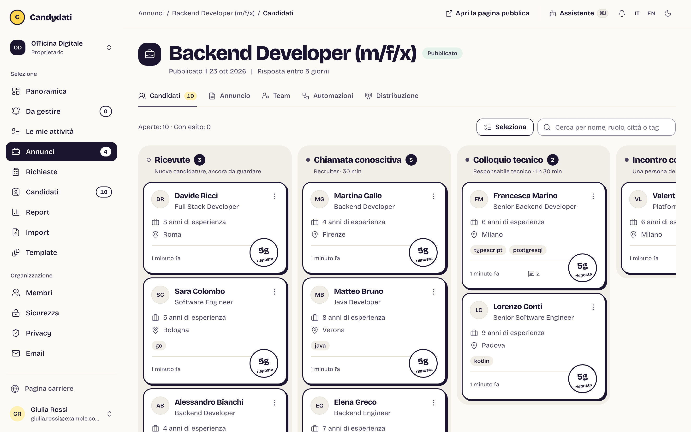
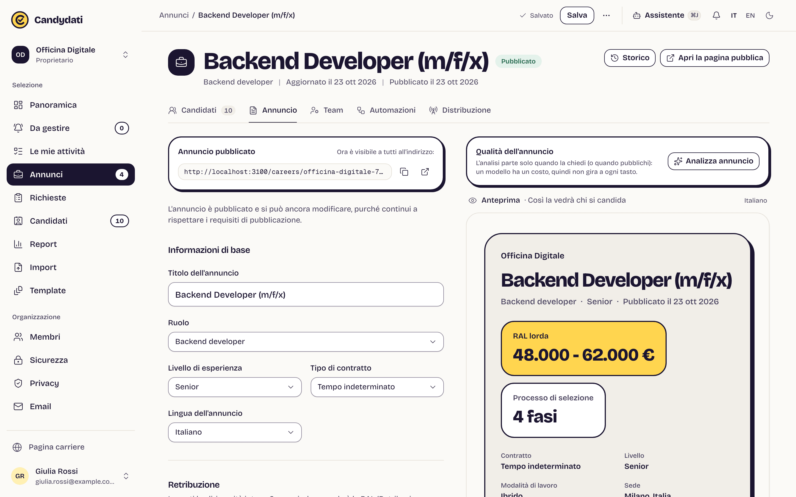
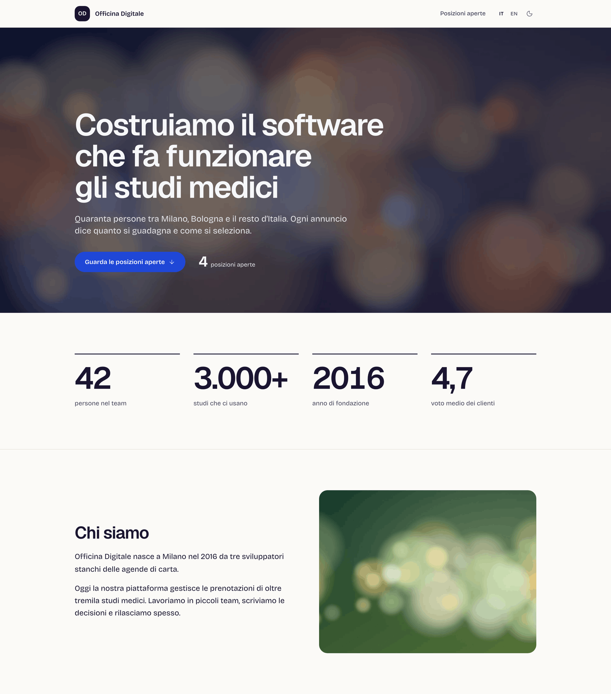
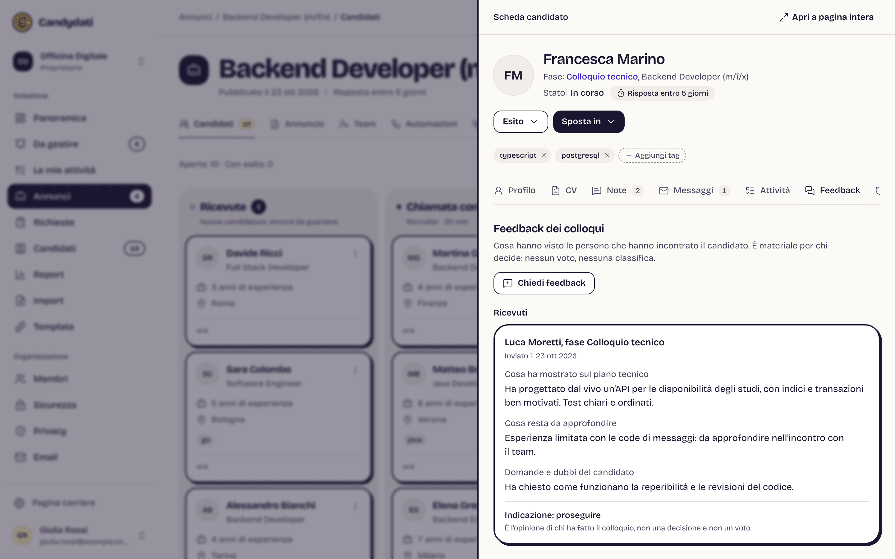
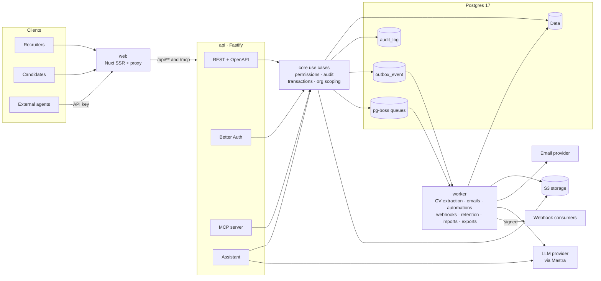
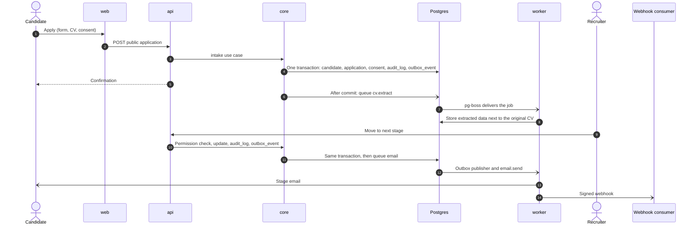

<p align="center">
  
  
</p>

<p align="center"><strong>An open, self-hostable agentic ATS built for candidates, not just recruiters.</strong></p>

<p align="center">
  <a href="LICENSE"></a>
  <a href="https://github.com/fabrilallo/candydati/actions/workflows/ci.yml"></a>
  <a href="CONTRIBUTING.md"></a>
  
</p>

<p align="center"><a href="README.it.md">Italiano</a> · <a href="docs/PRODUCT.md">Product</a> · <a href="docs/ARCHITECTURE.md">Architecture</a> · <a href="CONTRIBUTING.md">Contributing</a></p>

## Why

**An ATS is not the enemy.** Candidates often picture the applicant tracking system as a black box that hides their
CV or filters them out before a person reads it. Software does what the people running it decide: the same tool can
leave applicants in silence or answer every one of them. The difference lies in how it is set up and used.

That is why the source of Candydati is public. The rules it applies are code anyone can read, check and improve, and the
good practices are built into the product instead of being left to goodwill. Most hiring tools hide the salary, the
process and the outcome from the people who apply; here transparency is structural, not optional: a deployment cannot
switch these principles off.

- **Salary range in clear.** A job ad without a range cannot be published.
- **Declared selection process.** The stages, who runs them and how long each one takes are visible before applying.
- **No application without an outcome.** Every candidate gets an answer; a job with open applications cannot be closed.
- **No automated decisions.** The assistant works on the process. It never ranks, scores or rejects people. The only
  score in the product rates the job ad, not who applies; the CV reader extracts facts (roles, skills, languages) shown
  next to the original, without judging them.
- **Agentic-ready.** Everything in the UI is available through a REST API (OpenAPI) and an MCP server, with the same permissions.
- **GDPR by design.** Versioned consent, retention and automatic erasure, data subject rights, full export in open formats.

Status: pre-1.0 (see the [changelog](CHANGELOG.md)). Full product definition: [docs/PRODUCT.md](docs/PRODUCT.md).

## Features

**Hiring**
- Structured job ads with a deterministic publish standard (salary, process, contract, work mode) and Italian compliance checks
- Careers page with structured data (`JobPosting`), XML feed and a public read-only ads API
- Careers page builder: hero with image or video, gallery, values, numbers, testimonials and more, with live preview, drafts and publication; privacy-first video embeds
- Applications without registration, with versioned consent
- Pipeline whose stages are the ones declared in the ad; candidate database search; original CV next to extracted data

**Collaboration**
- Organizations, roles and per-job selection teams
- Interview feedback without login, via personal links
- Hiring needs intake, optional budget and salary approval, stalled job flags
- Reports: time to hire, conversion per stage, sources, response times

**Communication and automation**
- Email templates, single and bulk sends, inbound email attached to the candidate
- Response deadlines and reminders; triggers per stage (none decides about a candidate)

**Agents and integrations**
- REST API with OpenAPI, API keys, MCP server, process assistant (models via Mastra, off by default)
- Signed webhooks fed by a transactional outbox

**Privacy and data**
- Retention, automatic erasure, data subject rights, append-only audit log
- Import from CVs and spreadsheets with preview and undo; complete export

## Screenshots

| | |
|---|---|
| <br>**Pipeline**: candidates across the declared stages of a job | <br>**Job ad editor**: salary and process required, live preview |
| <br>**Careers page**: sections built in the page builder with a live preview | <br>**Candidate**: stage, notes and interview feedback, no scores |

Demo data is invented. Regenerate with `pnpm --filter @candydati/e2e screenshots` against a running dev stack.

## Quick start (development)

Requirements: Node 24, pnpm 10 (`corepack enable`), Docker with Compose v2.

```bash
cp .env.example .env
pnpm install
pnpm infra:up       # Postgres :5434, MinIO :9000
pnpm db:migrate
pnpm dev            # web http://localhost:3000, api http://localhost:4100
```

Locally, emails go to Mailpit (http://localhost:8025). Checks: `pnpm lint`, `pnpm typecheck`, `pnpm test`
(tests need `pnpm infra:up`). Every environment variable is listed in [docs/ENVIRONMENT.md](docs/ENVIRONMENT.md).

## Self-hosting

You need a Linux server with 2 vCPU and 4 GB RAM (for example Hetzner Cloud CX23 or the Arm CAX11, or OVHcloud
VPS-1: about €5–7 a month in October 2026), a domain pointing to it and an email account to send from (Resend or any
SMTP, including your company mailbox). No other accounts. On the server:

```bash
curl -fsSL https://github.com/fabrilallo/candydati/releases/latest/download/install.sh | sudo bash
```

The installer asks a few questions, installs Docker if missing, generates every secret and starts the whole stack
(Postgres 17, MinIO, api, worker, web) with automatic HTTPS (Caddy) and daily backups. It ends with the link that
creates the first owner. Day to day: `candydati status`, `candydati update`, `candydati backup`, `candydati help`.
Step by step: the [documentation site](https://fabrilallo.github.io/candydati/).

From the sources instead (`cp .env.example .env`, then `docker compose -f docker-compose.prod.yml up -d --build`), with
`SIGNUP_MODE=invite_only` the first owner signs up at `/signup?setup` with the one-time `BOOTSTRAP_TOKEN` from `.env`.
Guides:

- [Operations](docs/OPERATIONS.md): backups, upgrades, monitoring
- [Deploy with Docker Compose](docs/deploy/docker-compose.md), with network, volumes and several instances on one host
- [Deploy with Dokploy](docs/deploy/dokploy.md), also hands-off with a coding agent (Claude Code, Codex, Cursor) through [Dokploy's MCP server or CLI](docs/deploy/dokploy.md#set-it-up-with-an-ai-coding-agent-optional)
- [Environment variables](docs/ENVIRONMENT.md) and [reverse proxy log masking](SECURITY.md#reverse-proxy-access-logs)

## Architecture

Business logic lives only in `packages/core`. REST routes, assistant tools and MCP tools are thin adapters over the
same use cases, with the same permissions and the same audit trail.



Life of an application:



More in [docs/ARCHITECTURE.md](docs/ARCHITECTURE.md) and the [decision records](docs/adr/README.md).

## Documentation

- [Product](docs/PRODUCT.md): principles, scope, job ad standard, agent and GDPR approach
- [Architecture](docs/ARCHITECTURE.md) and [decision records](docs/adr/README.md)
- [Design system](docs/DESIGN-SYSTEM.md)
- [Environment variables](docs/ENVIRONMENT.md), [Operations](docs/OPERATIONS.md), [Migrations](docs/MIGRATIONS.md)
- [Public data schemas](docs/schema/README.md), [legal templates](docs/legal/README.md) (Italian, need legal review)

## Roadmap

No dates. Deferred from the current scope ([PRODUCT.md §3.3](docs/PRODUCT.md)):

- Scorecards and interview kits
- Restricted stages: feedback and notes visible only to owners, admins and the hiring manager
- Interview scheduling through an integration with a scheduling service
- Dedicated importers for individual ATS products

## Contributing

Contributions are welcome. Read [CONTRIBUTING.md](CONTRIBUTING.md) and the [Code of Conduct](CODE_OF_CONDUCT.md).
Tests are written first and live next to the code.

## Security

Report vulnerabilities privately as described in [SECURITY.md](SECURITY.md). Do not open public issues for them.

## Author

Created and maintained by **Fabrizio Lallo** (fabrizio.lallo95@gmail.com), founder of
[TechCompenso](https://techcompenso.com) and [XCompenso](https://xcompenso.com), and creator of
[FuffAnnuncio](https://www.fuffannuncio.com) and [Riccometro](https://www.riccometro.it). The job ad quality analysis in
this project is derived from FuffAnnuncio.

## License

[Business Source License 1.1](LICENSE) (`BUSL-1.1`), by Fabrizio Lallo.

- **Free:** read, modify and self-host it, including in production to run your own organization's hiring. Consultants
  may install and run it for a single organization's own hiring.
- **Requires a commercial license:** offering it to third parties as a hosted service (an ATS or recruiting SaaS) or
  embedding it in a product you sell. Write to fabrizio.lallo95@gmail.com.
- **Becomes open source:** each version converts to [GNU AGPL v3](https://www.gnu.org/licenses/agpl-3.0.html)
  (`AGPL-3.0-only`) four years after its first public release.

The license text is binding; this summary is not.

---

**Italiano.** ATS agentico, aperto e installabile sul tuo server, pensato per chi si candida: RAL in chiaro
obbligatoria, processo dichiarato, nessuna candidatura senza esito. Questo README in italiano: [README.it.md](README.it.md).
